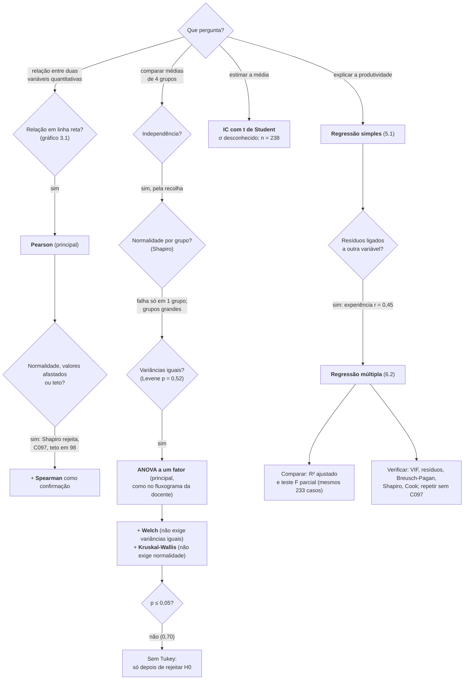

# Guião de apoio à defesa oral

Apoio para a parte «Defesa oral e domínio do trabalho» (10% da nota). Tudo o que está aqui tem prova no notebook (com a numeração do enunciado) e no relatório. Só usámos métodos dados nas aulas e nos materiais de apoio da docente.

## A mensagem em 60 segundos

A direção acredita que quem usa mais IA é mais produtivo. Nos dados, isso é verdade como tendência, mas fraca: a correlação entre horas de IA e produtividade é 0,24 e o uso de IA explica cerca de 6% das diferenças de produtividade. Quando comparamos colaboradores com a mesma experiência, formação em IA e complexidade de tarefas, a associação quase desaparece: o coeficiente da IA cai cerca de 80%, de 0,64 para 0,13 pontos por hora, e deixa de ser significativo. O que realmente pesa é a experiência: mais 1,6 pontos por cada ano. Quem usa mais IA é mais produtivo sobretudo porque tem mais experiência e formação. Por isso não recomendamos tornar a IA obrigatória: os dados mostram associação, não causa, e o ganho esperado seria pequeno mesmo no melhor cenário.

## Mapa do notebook

Cada bloco de código começa com um comentário `BLOCO x.y` que diz o que faz, porquê e como se lê o resultado. Os números dos blocos seguem a numeração do enunciado, por isso o diagrama serve de índice. Os diagramas são Mermaid: aparecem desenhados no GitHub e no VS Code (com a extensão *Markdown Preview Mermaid Support*).

```mermaid
flowchart TD
    A["<b>0 · Configuração</b><br/>0.1 descarregar o Excel do GitHub<br/>0.2 bibliotecas, cores, funções qq() e guardar()"] --> B

    subgraph P1["1 · Preparação dos dados"]
        B["1.0 ler o Excel<br/>241 linhas × 11 variáveis"] --> C["1.1 contar<br/>241 linhas / 240 códigos"]
        C --> D["1.2a procurar repetidos<br/>C084 duas vezes, linhas iguais"]
        D --> E["1.2b retirar a cópia<br/>→ 240 colaboradores"]
        E --> F["1.3 valores em falta<br/>8 valores em 8 registos<br/><i>decisão: não preencher</i>"]
        F --> G["1.4 tipos de variáveis<br/>1.4b dicionário do Excel<br/>resposta = produtividade"]
        G --> H["1.5a/b corrigir departamentos<br/>7 grafias → 4 categorias"]
        H --> I["1.5c teto, valores estranhos, impossíveis<br/>teto em 98; C097 = 19<br/><i>decisão: manter C097 e repetir sem ele</i>"]
        I --> J["1.6 casos por análise: 238 · 236 · 233<br/>1.6b os registos com falhas mudam algo?<br/>r = 0,241 (236) vs 0,246 (233): não"]
    end

    J --> K

    subgraph P2["2 · Descrição"]
        K["2.1 média vs mediana<br/>2.2 uso de IA e valores altos (C134, C035)<br/>2.3 por departamento<br/>2.4 simetria: histograma, caixa, Q-Q, Shapiro<br/>2.5 mais produtivo ≠ quem mais usa IA"]
    end

    K --> L

    subgraph P3["3 · Associação"]
        L["3.1 dispersão + reta + quartis"] --> M["3.2 Pearson r = 0,24<br/>Spearman ρ = 0,27"]
        M --> N["3.3 fraca (escala da docente: 0,2–0,4)<br/>3.4 contraexemplos<br/>3.5 associação ≠ causa"]
    end

    N --> O

    subgraph P4["4 · Inferência"]
        O["4.1 caixas por departamento"] --> Q["4.2 hipóteses H0 / H1"]
        Q --> R["4.3 condições<br/>Shapiro por grupo + Levene p = 0,52"]
        R --> S["4.4a ANOVA p = 0,70 + Kruskal-Wallis p = 0,71<br/>4.4b Welch p = 0,68<br/>η² = 0,006 (abaixo de 0,01)"]
        S --> T["4.5 não rejeitar H0 ≠ provar igualdade<br/>sem Tukey"]
        T --> U["4.6 IC 95% da média<br/>[76,4 ; 79,7]"]
    end

    U --> V

    subgraph P5["5 · Regressão simples (M1)"]
        V["5.1–5.2 ŷ = 73,04 + 0,627 × IA"] --> W["5.3 5 h vs 10 h: +3,1<br/>5.4 R² = 0,058<br/>5.5 resíduo do C001 = −9,9"]
        W --> X["5.6a resíduos e pressupostos<br/>5.6b sem C097<br/>5.6c resíduos ligados à experiência (r = 0,45)"]
    end

    X -->|"falta uma variável"| Y

    subgraph P6["6 · Regressão múltipla (M2)"]
        Y["6.1 correlações<br/>excluir indicadores do mesmo desempenho"] --> Z["6.2–6.3 M2 = IA + experiência<br/>+ formação + complexidade"]
        Z --> AA["6.4 coeficiente da IA<br/>0,64 → 0,13 (−80%)"]
        AA --> AB["6.5 R² ajustado 0,056 → 0,267<br/>teste F parcial p < 0,001"]
        AB --> AC["6.6a VIF ≤ 1,51 + resíduos<br/>6.6b robustez: sem C097, + carga e departamento,<br/>complexidade como categoria, interação"]
        AC --> AD["6.7 escolher o M2"]
    end

    AD --> AE["<b>7 · Conclusões</b><br/>descritivo · inferencial · explicação · recomendação"]
```

## Tratamento dos dados: o que fizemos e porquê

| Problema encontrado | Bloco | O que fizemos | Porque não fizemos de outra forma |
|---|---|---|---|
| C084 repetido (2 linhas iguais em tudo) | 1.2 | Ficou só uma linha | É a mesma pessoa copiada; o dicionário diz que cada pessoa aparece uma vez. Manter as duas daria peso a dobrar ao C084. |
| 8 valores em falta, um por registo | 1.3, 1.6b | Não preenchemos; cada análise usa quem tem a informação de que precisa | Preencher (por exemplo, com a média) seria inventar dados. Cada registo só sai das análises a que lhe falta informação e os resultados não mudam (r = 0,241 com 236 casos e 0,246 com 233). |
| Falta a produtividade a C030 e C131 | 1.6b | Ficam fora de tudo o que usa a produtividade | É a variável que queremos explicar: preenchê-la seria inventar o resultado. |
| Falta o uso de IA a C067 e C113 | 1.6b | Ficam fora da correlação e das regressões | É a variável que estudamos; entram na descrição e na comparação entre departamentos. |
| Faltam experiência, formação ou complexidade (C080, C189, C202) | 1.6b | Só saem da regressão múltipla | Entram em tudo o resto. |
| Falta o tempo por tarefa a C154 | 1.6b | Entra em todas as análises | É uma variável que não usamos nos modelos. |
| 3 grafias erradas de departamento | 1.5b | Corrigidas (4 departamentos) | Sem isto a ANOVA teria 7 «departamentos», 3 deles com uma pessoa. |
| C097 com produtividade 19 (o seguinte é 43,5) | 1.5c | Mantido; análises repetidas sem ele | Não há prova de erro e o valor está dentro da escala. A docente diz: um valor estranho investiga-se, não se elimina automaticamente. Sem ele nada muda. |
| C134 e C035 com cerca de 25 h de IA | 2.2 | Mantidos | São possíveis (meia semana de trabalho) e a distância de Cook mostra que não pesam demasiado. |
| Teto: 13 colaboradores com produtividade 98 | 1.5c | Mantidos; registado como limitação | Não se corrige sem saber como a avaliação é feita. Explica parte da falta de normalidade. |
| Complexidade é ordinal (1 a 5) | 1.4, 6.6b | Tratada como número | Simplifica o modelo; como categoria nada muda (F parcial p = 0,20). |
| Tarefas, tempo por tarefa e qualidade | 6.1 | Ficam fora dos modelos | O dicionário diz que são indicadores do mesmo desempenho, medidos ao mesmo tempo (não são componentes da produtividade). Explicar o desempenho com o próprio desempenho não ensina nada. |

## Porque escolhemos cada teste, e não outro

| Pergunta | Teste escolhido | Alternativa que não usámos (ou só como confirmação) | Porquê |
|---|---|---|---|
| A produtividade é normal? (2.4, 4.3) | Shapiro-Wilk + gráfico Q-Q | Kolmogorov-Smirnov | O infográfico da docente recomenda o Shapiro-Wilk para amostras pequenas e médias. O Q-Q mostra *onde* falha (ponta de baixo e teto). |
| IA e produtividade andam juntas? (3.2) | Pearson | Spearman (confirmação) | Duas variáveis quantitativas com relação em linha reta: Pearson. O Spearman confirma porque não depende da normalidade nem dos valores afastados. Deram o mesmo (0,24 e 0,27). |
| Diferenças entre 4 departamentos (4.4) | ANOVA a um fator | Vários testes t | Com 4 grupos seriam 6 testes t e o risco de pelo menos uma diferença «falsa» subia para cerca de 26%. A ANOVA faz um único teste. |
| E se as condições falharem? | Welch e Kruskal-Wallis (confirmação) | Só um deles | Welch protege contra variâncias diferentes (grupos de 31 a 85), Kruskal-Wallis contra a falta de normalidade. Os três dão p ≈ 0,7. |
| Variâncias iguais? (4.3) | Levene (com mediana) | Bartlett | O Bartlett é muito sensível à falta de normalidade, que aqui existe. O Levene com mediana é o dos guiões das aulas. |
| Comparações par a par | Nenhuma | Tukey | Só se faz depois de a ANOVA rejeitar H0. Aqui p = 0,70. |
| Estimar a média (4.6) | IC com t de Student | IC com a normal (z) | Não conhecemos o desvio-padrão da população. Com n = 238, t e z quase coincidem. |
| Explicar a produtividade (5, 6) | Regressão linear | Classificar a produtividade em grupos | A produtividade é contínua (0 a 100); dividi-la em grupos perde informação. Os coeficientes leem-se diretamente em pontos. |
| O M2 é melhor do que o M1? (6.5) | R² ajustado + teste F parcial | R² simples | O R² sobe sempre que se juntam variáveis; o ajustado desconta-as. O F parcial testa as 3 variáveis juntas. |
| Variáveis explicativas a dizer o mesmo? (6.6) | VIF | Só a matriz de correlações | O VIF vê a relação de cada variável com *todas* as outras ao mesmo tempo. |
| Variância dos resíduos constante? (5.6, 6.6) | Gráfico dos resíduos + Breusch-Pagan | Só o gráfico | Primeiro olhar, depois testar, como nas aulas 4 e 5. |
| Normalidade dos resíduos falha (6.6) | Repetir sem C097 | Transformar a produtividade (log) | A falha vem quase só do C097: sem ele os resíduos ficam normais (p = 0,97) e o coeficiente da IA quase não muda. Transformar mudaria a escala e dificultava explicar os coeficientes. |

## Números a saber de cor

| O quê | Valor | Onde |
|---|---|---|
| Linhas / colaboradores / casos no modelo múltiplo | 241 / 240 / 233 | 1.1, 1.6 |
| Valores em falta | 8, um em cada um de 8 registos | 1.3 |
| Produtividade média (mediana) | 78,0 (79,4) | 2.1 |
| Uso médio de IA | 7,7 h por semana | 2.2 |
| Correlação IA–produtividade (Pearson / Spearman) | 0,24 / 0,27, p < 0,001 (fraca) | 3.2, 3.3 |
| Departamentos (ANOVA / Welch / Kruskal-Wallis) | p = 0,70 / 0,68 / 0,71; η² = 0,006 | 4.4 |
| IC 95% da produtividade média | [76,4 ; 79,7] | 4.6 |
| Modelo simples | 73,04 + 0,627 × uso de IA; R² = 0,058 | 5.2, 5.4 |
| Coeficiente da IA no modelo múltiplo | 0,129; p = 0,47; IC −0,22 a 0,48 | 6.3 |
| Experiência no modelo múltiplo | 1,58 por ano; p < 0,001 | 6.3 |
| R² ajustado simples vs múltiplo (mesmos 233 casos) | 0,056 vs 0,267; F parcial (3, 228) = 23,1 | 6.5 |
| VIF máximo | 1,51 | 6.6 |

## Perguntas prováveis e respostas curtas

**Porque não preencheram os valores em falta?** São 8 valores, um em cada um de 8 registos, menos de 1% por variável. Preencher pela média seria inventar dados e diminuía a variação real. Cada registo só sai das análises a que lhe falta informação, e verificámos que isso não muda os resultados: a correlação é 0,241 com 236 casos e 0,246 com 233 (1.3, 1.6b).

**Porque mantiveram o C097, com produtividade 19?** Não há prova de erro: o valor está dentro da escala. Seguimos a regra das aulas, investigar em vez de eliminar: repetimos as análises principais sem ele e nenhuma conclusão muda (3.2, 4.4, 5.6, 6.6).

**Porquê Pearson e também Spearman?** Pearson porque as duas variáveis são quantitativas e a relação parece em linha reta. Spearman como confirmação, porque a produtividade não é normal, tem valores afastados e um teto em 98. Dizem o mesmo (3.2).

**Porque dizem que a associação é fraca se o p é tão pequeno?** Porque o p diz se a relação é diferente de zero, não se é forte. Com 236 pessoas, até uma relação fraca se distingue do zero. Na escala da docente, 0,2 a 0,4 é fraca (3.3).

**A normalidade falha num grupo, mesmo sem C097. Porque usaram a ANOVA?** Seguimos o fluxograma da docente: com o Levene a não rejeitar (p = 0,52), o teste indicado é a ANOVA. Com grupos grandes (31 a 85) e variâncias parecidas, a ANOVA aguenta bem desvios moderados da normalidade. E confirmámos com o Welch (não exige variâncias iguais) e o Kruskal-Wallis (não exige normalidade): os três dão o mesmo (4.3, 4.4).

**O que quer dizer p = 0,70 aqui?** Se as médias fossem iguais nos quatro departamentos, diferenças como as que vimos apareceriam em cerca de 70% das amostras. Não rejeitamos a igualdade, mas isso não a prova (4.4, 4.5).

**Porque não fizeram o teste de Tukey?** Porque só se faz depois de a ANOVA encontrar diferenças. Aqui p = 0,70 e η² = 0,006, abaixo até do limiar de efeito pequeno (4.5).

**Porque deixaram de fora tarefas concluídas, tempo por tarefa e qualidade?** O dicionário da base diz que são indicadores do mesmo desempenho, medidos ao mesmo tempo. A produtividade não é calculada a partir deles, mas mede a mesma coisa. Explicar o desempenho com outras medidas do desempenho faria subir o R² sem ensinar nada, e podia esconder o efeito da IA se ela atuar através dessas vias (6.1).

**Porque é que o coeficiente da IA cai tanto no modelo múltiplo?** Porque a experiência estava «escondida» por trás da relação: quem tem mais experiência usa mais IA (r = 0,27) e é mais produtivo (r = 0,50). Não é multicolinearidade: os VIF são baixos e o erro-padrão do coeficiente quase não muda (6.4, 6.6).

**A formação não estará a apagar um efeito real da IA?** Pode estar, se a formação levar a usar mais IA. Por isso mostramos que, só com a experiência (que não resulta de usar IA), o coeficiente já cai para metade (0,31) (6.4).

**O modelo múltiplo é mesmo melhor?** Sim: com os mesmos 233 casos, o R² ajustado passa de 0,06 para 0,27 e o teste F parcial às três variáveis dá p < 0,001. Mesmo assim, 73% da variação fica por explicar (6.5).

**Os resíduos não são normais. Os valores-p valem?** A falha vem quase só do C097. Sem ele, os resíduos do modelo múltiplo são compatíveis com a normalidade (p = 0,97) e o coeficiente da IA quase não muda (0,146; p = 0,38) (6.6).

**O que significa o Durbin-Watson aqui?** Quase nada, e a docente diz o mesmo: mede a relação entre resíduos seguidos, o que só faz sentido com uma ordem no tempo. Aqui a ordem é a do código do colaborador. Está lá só por completude; a independência vem da forma como os dados foram recolhidos (5.6).

**O intervalo de previsão para 10 h vai até 104. O modelo faz sentido?** A reta não sabe que a escala acaba em 100. É um sintoma do teto em 98 e do R² baixo: o modelo descreve a tendência média, não prevê pessoas concretas (5.3).

**Testaram se o efeito da IA depende da experiência?** Sim: o termo de interação IA × experiência é praticamente nulo (0,028; p = 0,50) (6.6b).

**Então a IA não serve para nada?** Não é isso que os dados dizem. Dizem que, nestes dados, as horas de IA não estão associadas a mais produtividade depois de ter em conta a experiência e a formação. A formação em IA mostra uma relação positiva no limite da significância (p = 0,06). O efeito pode depender do tipo de tarefa e de como a IA é usada, que não foi medido (7.4, 7.5).

**O que fariam para provar uma causa?** Um estudo piloto: dar acesso e formação em IA a equipas escolhidas ao acaso, medir a produtividade antes e depois, com uma escala sem teto (7.5).

**Que limitações destacam?** O tipo de estudo (uma só medição, sem distribuição ao acaso do uso de IA) e a qualidade dos dados (sintéticos, com teto em 98, um valor suspeito e um uso de IA medido só em horas) (7.4).

## Alinhamento com a apresentação antiga do Rúbem

Na apresentação antiga do Rúbem (`MEIA_G01_Apresentacao.pptx`, já retirada do repositório) o «modelo múltiplo» tinha também a carga de trabalho e o departamento (coeficiente da IA 0,144) e usava erros-padrão HC3, Welch como teste principal e uma classificação multinomial. No trabalho final o modelo principal é o M2 (0,129), o teste principal é a ANOVA clássica e os métodos que não foram dados em aula saíram. A nova apresentação (`Apresentacao_TP1_MEPA.pptx`) segue o trabalho final. Se perguntarem pela diferença: «o coeficiente da IA fica entre 0,13 e 0,14, conforme se junte ou não a carga e o departamento; escolhemos o modelo mais simples porque o departamento não explica a produtividade (ANOVA p = 0,70)».

## Figuras para mostrar

- Figura 3 do relatório (3.1): dispersão com a reta e caixas por quartil, para mostrar a tendência fraca com muita dispersão.
- Figura 7 do relatório (6.4): o coeficiente da IA a encolher à medida que se juntam variáveis. É o gráfico que conta a história do «paradoxo».
- Tabela 10 do relatório ou a síntese final do notebook: os quatro níveis (descritivo, inferencial, explicação estatística e recomendação).
